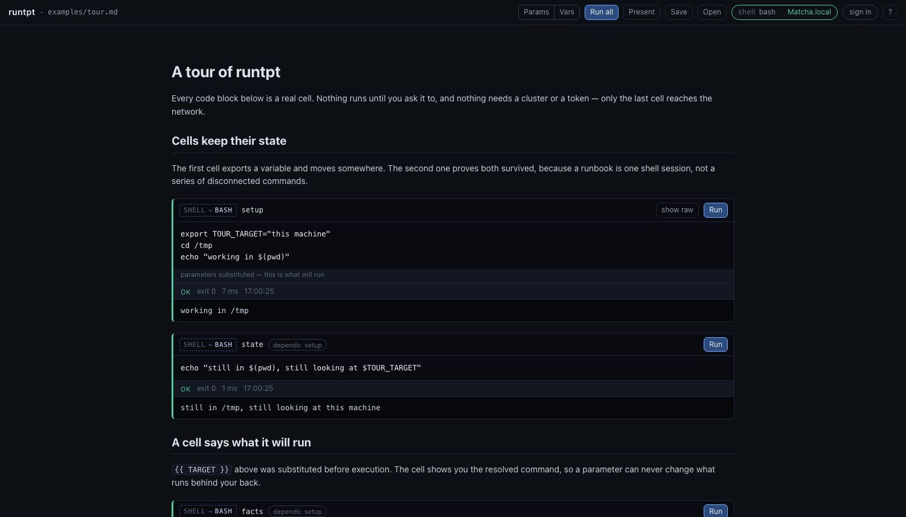
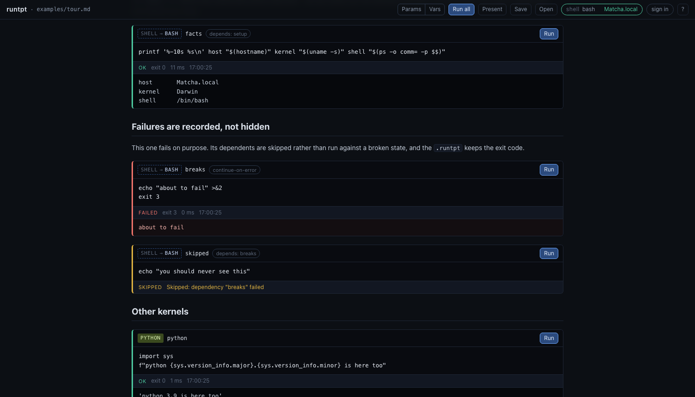
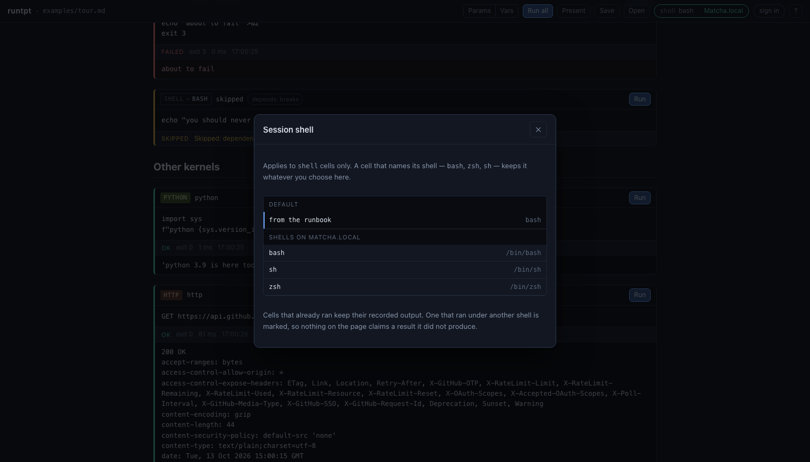
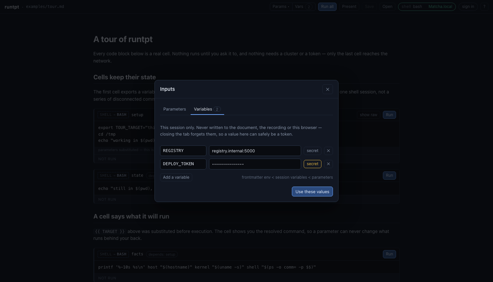
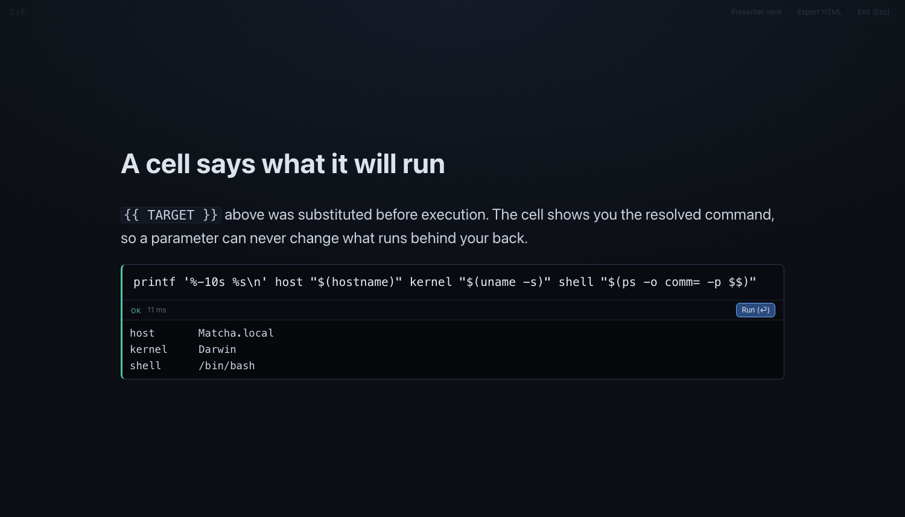
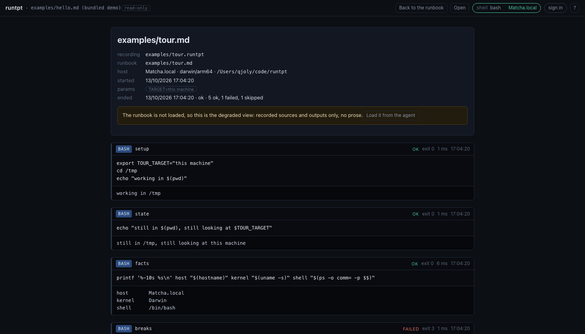

# runtpt

Executable markdown runbooks, GitHub-first.

A runbook is a plain `.md` file in a Git repository. runtpt opens it in the browser,
runs its code cells on **your** machine through a local agent, and records every output
in a side-car `.runtpt` file. The same file can be projected as a slide deck without
changing a line.



## Why

Operational knowledge ends up in one of two bad places. Markdown runbooks in a repo are
reviewable and diffable, but nobody can tell whether the commands still work. Notebooks
execute, but `.ipynb` is a JSON blob that reviews badly, carries stale output into
commits, and assumes Python.

runtpt keeps the markdown as the only source of truth and treats execution as something
that happens *to* it, never *inside* it.

## Quick start

```bash
npm install
npm run dev                  # the web app, with a demo runbook already loaded
npx @runtpt/agent serve      # in the directory holding your runbooks
```

The agent prints a pairing link. Open it and the browser is wired to your machine —
nothing is sent to a server, because there isn't one.

For CI, skip the browser:

```bash
runtpt run runbooks/incident.md --out incident.runtpt
```

It exits non-zero when a cell fails, so a repository can prove its own documentation
still works. This repo does exactly that with [`examples/selftest.md`](examples/selftest.md).

## What a cell looks like

Executable cells are ordinary fenced code blocks. A fence with no runtpt attribute stays
inert, so existing documentation does not suddenly become executable.

````markdown
```shell run id=check-nodes timeout=30s
kubectl --context "{{ CLUSTER }}" get nodes
```
````

The full dialect — attributes, kernels, parameters, slides — is in
[docs/MARKDOWN.md](docs/MARKDOWN.md).

## Outcomes are recorded, not hidden

A failing cell keeps its exit code. Cells that depend on it are skipped rather than run
against a broken state. `continue-on-error` lets the run carry on without pretending the
failure did not happen.



## A cell never lies about what it runs

` ```shell ` inherits the runbook's shell and says what it resolved to. ` ```bash ` pins
bash and is immune to the session override. The badge always names the interpreter that
will actually run.



## Parameters and variables

Parameters are declared in the runbook. Session variables are not: you type them in, they
are merged under the parameters, and they are never written to the document, the
recording or browser storage. A variable marked secret is redacted before any output
reaches the browser — and the agent unsets it when the tab closes, so it does not linger
in a shell that outlives the browser.



## The same file, presented

Press `P`. Headings become slides, prose is typeset for projection, and the cells stay
live — running one streams its output onto the slide. A presenter window carries the
speaker notes and a timer.



## Replay

A `.runtpt` opens as a document in its own right: the run's host, parameters and timings,
each cell with the output it actually produced. If the runbook has drifted since, the
affected cells are flagged. If the runbook is missing entirely, the recording still
renders from what it stored.



## Packages

| Package | Role |
|---|---|
| `@runtpt/core` | markdown dialect, cell identity, parameters, run plan, slides |
| `@runtpt/format` | `.runtpt` streaming writer, tolerant reader, redaction |
| `@runtpt/protocol` | the browser/agent wire protocol |
| `@runtpt/agent` | the local binary: kernels, paired server, headless runs |
| `@runtpt/web` | the SPA: browse, run, replay, present |

## Documentation

- [Getting started](docs/GETTING-STARTED.md) — install, pair, first run, CI
- [Specification](docs/SPEC.md) — scope, requirements, security model, open questions
- [Markdown dialect](docs/MARKDOWN.md) — frontmatter, cells, attributes, kernels
- [`.runtpt` format](docs/FORMAT.md) — records, redaction, git hygiene
- [Architecture](docs/ARCHITECTURE.md) — packages, protocol, rejected alternatives
- [Roadmap](docs/ROADMAP.md)

Two runbooks to try: [`examples/tour.md`](examples/tour.md) needs nothing but a shell,
and [`examples/hello.md`](examples/hello.md) is what an ops runbook actually looks like.

## Status

The v1 scope is implemented and tested. The parts most likely to bite first: the GitHub
Device Flow has never been exercised against a real OAuth app (the token path has),
`interactive` cells are not a real PTY, and a cell that calls `exit` necessarily ends the
persistent shell — the exit code survives, the shell state does not.

The name comes from the output extension and was meant as a placeholder.

## Licence

MIT.
